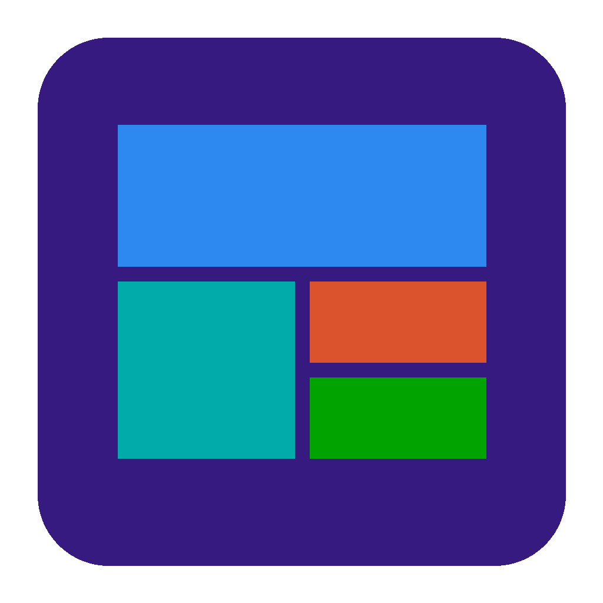

<p align="center"></p>

# WinTiles

**An open-source Start screen for Windows 11 that brings back the Windows 8 look and feel** — flat colored tiles, named groups, the tile cascade, and **Live Tiles** that flip to show the time, weather, your next meeting, headlines, photos and system stats.

WinTiles is the Windows sibling of [MacTiles](https://github.com/1notone/MacTiles) (the same app for Apple silicon Macs): same features, same look, and the same `layout.json` format, so you can copy a layout between them. (WinTiles was called *Tessera* before version 1.2.)

Like Windows 8, Start is always there: launch an app and Start slips behind it, staying on your desktop so it's what you see whenever your windows are closed or minimized. Press **Ctrl + Alt + Space** — or, if you like, the **Windows key** — to bring it back to the front.

Native C# / WPF on .NET 10. No telemetry, no accounts. Live tiles pause whenever Start is hidden or covered by a maximized window, so it costs next to nothing in the background.

> WinTiles is an independent project and is not affiliated with or endorsed by Microsoft. Windows is a trademark of the Microsoft group of companies.

## Features

**The Start screen**
- Lives on your desktop behind your apps, Windows 8 style; its tiles stay clickable there
- Bring Start to the front with **Ctrl + Alt + Space** (configurable), the **Windows key** (optional), the tray icon, or the bottom-left hot corner
- Tiles in four sizes — small, medium, wide, large — packed into groups exactly like Windows 8.1
- **Tile shape**: Square (classic), Soft or Round squircle corners
- Drag tiles to reorder (neighbours slide out of the way as you drag); drop past the last group to start a new one
- Drag a group by its name to move it left or right; double-click the name to rename it
- Right-click a tile to resize, recolor, move to another group, open its file location, or unpin it
- Drag any app, shortcut or `.exe` from File Explorer onto Start to pin it
- Tiles fly in with the staggered Windows 8 cascade and "tilt" when pressed (respects Windows' animation setting)
- A plain mouse wheel scrolls Start sideways
- Right-click any empty spot for **WinTiles Settings…**, Add Live Tile, All Apps and Show Desktop
- Any background color: presets, a color wheel with brightness, or a hex code
- **Wallpapers**: a picture, an animated GIF or a looping video (with a Dim slider), or one of four **live wallpapers** drawn by WinTiles (Aurora, Ribbons, Bokeh, Squares) tinted with your color. Animated wallpapers pause when Start is hidden or covered, with animation effects off, and in battery saver.
- **Tile finish**: Flat (classic Metro) or **Glass** — translucent tiles with a gloss, a polished rim, a highlight that follows the pointer and a shimmer on hover; a Glass tint slider. **Tile shadow**: None, Subtle, Medium or Strong.
- **Running indicator**: a small glowing dot on tiles (and in All apps) of apps that have a window open. Right-click to **Quit** the app, or **Force Quit…** one that isn't responding.
- **Web tiles**: pin any web address (Add Web Tile…, or drag a link from your browser onto Start). Tiles show the site's own icon — the sharpest it offers — and its page title.

**Apps & search**
- **All apps** (the ↓ arrow, bottom-left): every app in your Start menu — desktop and Microsoft Store apps — A–Z, grouped by letter. New and removed apps show up within seconds.
- **Just start typing** to search — there's no search box. Matches prefixes, words, substrings and initials (`vsc` → Visual Studio Code). Enter opens the top hit; Backspace erases (Ctrl+Backspace a word, Ctrl+Shift+Backspace everything); Esc clears / closes.
- Apps you open get keyboard focus straight away; WinTiles stays behind them.

**Live Tiles**

| Tile | Shows | Source |
|---|---|---|
| Clock | Digital time & date, flips to an analog face | Local |
| Calendar | Today's date; optionally your next events | Any iCalendar (.ics) feed — Outlook, Google, iCloud |
| Weather | Current conditions, high/low, 3-day forecast, for a city or a ZIP / postal code | [Open-Meteo](https://open-meteo.com) (free, no key) |
| System | CPU % with sparkline, memory use | Windows system APIs |
| Battery | Charge, charging state, time remaining | Windows power status |
| Photos | Slideshow from a folder (default: Pictures) | Local files |
| News | Rotating headlines from any RSS/Atom feed. Add several, each with its own source (right-click → *Change Feed…*) | Your chosen feeds |
| Desktop | Your current wallpaper; click to go to the desktop | Local |

**Service tiles (homelab integrations)**

The same kinds of widgets [Homarr](https://homarr.dev) offers, as Metro tiles. WinTiles talks to each service's own API directly — Homarr isn't needed. Same services as MacTiles:

| Service | Tile shows | You can |
|---|---|---|
| Plex, Jellyfin, Emby | Now playing (who, what, progress) or recently added, with posters | |
| Sonarr, Radarr | Upcoming episodes / releases, queue and missing counts | |
| Overseerr / Jellyseerr | Pending and recent requests, with posters | |
| Pi-hole (v6 and v5), AdGuard Home | Queries, % blocked, clients, blocklist | Pause blocking (1 min → until resumed), resume |
| Home Assistant | Any entity: lights, switches, sensors, climate, covers, media players, scripts, scenes, automations | Click to toggle or run (locks only from the menu) |
| UniFi Network | Clients, devices, latency, speed, WAN IP, gateway load | |
| OPNsense | Live traffic per interface (WAN speed + sparkline), gateways, firewall states, memory, load, uptime | |
| Proxmox VE, TrueNAS, Unraid, Glances | CPU, memory, storage, uptime, guests / pools / array | |
| Docker | Containers, running first — Docker Desktop on this PC, or a remote Docker API | Start, stop, restart |
| Beszel | Systems up, average CPU / memory / disk — or one system in full | |
| ComfyUI | Live job progress, queue, VRAM / RAM (and GPU load, temperature and CPU with ComfyUI-Crystools), latest images | Interrupt, clear queue |

Connect services in **Settings → Integrations → Add Service…** (with a Test Connection button), then right-click Start → **Add Service Tile…**. Passwords, tokens and API keys are stored in **Windows Credential Manager**, never in layout.json. Self-signed certificates are accepted only where you allow them, and only from that service's own server; keys aren't passed on when a service redirects to a different server, and the editor warns you if a key would go over plain HTTP to an address outside your network. Service tiles poll only while Start can be seen, each at its own pace (ComfyUI every 2 s, upcoming episodes every 5 min).

## Requirements

- Windows 11 (or Windows 10 version 2004+), on an **x64** or **Arm64** PC — including Windows 11 on Arm in Parallels/VMware on an Apple silicon Mac
- Nothing else: the installer includes everything WinTiles needs

## Install

1. Download **WinTiles-x.y.z-x64-setup.exe** (most PCs) or **…-arm64-setup.exe** (Arm PCs, Copilot+ PCs, Parallels on a Mac) from the [latest release](../../releases/latest).
2. Run it. No administrator rights needed — WinTiles installs just for you, in `%LOCALAPPDATA%\Programs\WinTiles`.
3. WinTiles opens when setup finishes, and (unless you untick the option) each time you sign in.

If Windows SmartScreen says it "protected your PC", the release isn't code-signed yet: click **More info → Run anyway**.

Upgrading from **Tessera** (WinTiles' earlier name)? Just run the WinTiles installer: it removes Tessera and WinTiles carries over your tiles, settings, saved service keys and sign-in startup.

Prefer no installer? Download the **portable .zip**, unzip anywhere and run `WinTiles.exe`.

To remove WinTiles: **Settings → Apps → Installed apps → WinTiles → Uninstall**, or WinTiles' own **Settings → Uninstall WinTiles…**. The uninstaller asks whether to delete your tiles, settings and saved service keys too.

### Build it yourself

The easiest way: on a Windows 11 PC, unzip the source and double-click **Build Installer.cmd**. The first time, it installs the .NET 10 SDK and Inno Setup with winget; then it runs the tests and opens `artifacts\release`, which holds `WinTiles-<version>-x64-setup.exe` (or arm64 on Arm PCs) and a portable zip.


On Windows, with the [.NET 10 SDK](https://dotnet.microsoft.com/download) and [Inno Setup 6](https://jrsoftware.org/isinfo.php):

Clone this repository (or download it with **Code → Download ZIP**), then in its folder:

```powershell
winget install Microsoft.DotNet.SDK.10 JRSoftware.InnoSetup
.\build.ps1          # tests, then artifacts\release\WinTiles-<version>-x64-setup.exe, -arm64-setup.exe and portable zips
```

Quick development loop: `dotnet run --project src\WinTiles`. Tests: `dotnet test` (they also run on macOS and Linux).

No Windows machine handy? Push to GitHub — the **Build** workflow makes unsigned installers for every commit (*Actions → Build → Artifacts*).

## Using WinTiles

### How Start behaves

| State | What you see | How you get there |
|---|---|---|
| **Front** | Start covers the screen, ready to type | Ctrl+Alt+Space, Windows key (optional), tray icon, hot corner |
| **On the desktop** | Start sits behind all your windows; tiles still work | Launch an app, press Esc, or click another app |
| **Hidden** | Start is gone; your real desktop and icons are back | The Desktop tile, or tray icon → Show Desktop |

Prefer Start to disappear completely after you launch something? Turn off **Settings → Behavior → Keep Start on the desktop**.

### Everyday actions

| Action | How |
|---|---|
| Launch an app | Click its tile, or just start typing its name and press Enter |
| All apps | ↓ arrow at bottom-left; ↑ to go back |
| Pin an app | Right-click it in All apps → Pin to Start, or drag it from File Explorer |
| Add a live tile | Right-click an empty spot, the ••• menu, or the tray icon → Add Live Tile |
| Add another News tile | Add Live Tile → News, then pick a feed (or *Popular feeds*); right-click a News tile → Change Feed… to switch it |
| Add a web tile | Right-click an empty spot → Add Web Tile…, or drag a link from your browser onto Start |
| Add a service tile | Settings → Integrations → Add Service…, then right-click an empty spot → Add Service Tile… |
| Change the wallpaper | Right-click an empty spot → Change Wallpaper…, or Settings → Background |
| Quit a running app | Right-click its tile (the one with the dot) → Quit |
| Hot corner as a toggle | Settings → Opening Start → "Corner also puts Start away…" |
| Move a group | Drag its name left or right, or right-click it → Move Group Left/Right |
| Tile shape | Settings → Tile shape: Square, Soft or Round |
| Background color | Settings → a preset, the color wheel, or a hex code |
| Settings | Right-click an empty spot → WinTiles Settings…, ••• → Settings, Ctrl+, or the tray icon |

**Weather** needs a place: Settings → Live tiles → type a city → Find, or a ZIP / postal code → Use (looked up in Windows' region).
**Calendar events**: paste an iCalendar address in Settings → Calendar feed (Outlook: *Settings → Calendar → Shared calendars → Publish a calendar → ICS*; Google: *Settings → your calendar → Secret address in iCal format*).
**The Windows key** option makes a *tap* of the Windows key open WinTiles instead of the Start menu; shortcuts like Win+E, Win+D and Win+Shift+S keep working.

## Your layout

Everything is stored in one readable JSON file, in the same format as MacTiles:

```
%APPDATA%\WinTiles\layout.json
```

Hand-edit it, back it up, or copy it from a Mac (`~/Library/Application Support/MacTiles/layout.json`) — Mac app tiles are skipped, everything else carries over. Missing keys fall back to defaults, out-of-range values are clamped to what Settings allows, and if the file can't be read WinTiles saves a copy beside it before restoring the default layout. Settings → *Show Layout File* reveals it in File Explorer. Problems are logged to `%APPDATA%\WinTiles\wintiles.log`.

## Project layout

```
src/WinTiles.Core/        platform-neutral logic (tested on any OS)
  Models.cs              Tile, TileGroup, sizes, kinds, shapes, settings
  LayoutJson.cs          layout.json reading (lenient) and writing — same schema as MacTiles
  Packer.cs              Windows 8.1 tile packing and grid metrics
  LayoutOps.cs           moving tiles and groups, pinning, default layout
  Search.cs              search ranking, A–Z headings, type-to-search
  Palette.cs             Metro palette, hex/HSV, icon tinting
  Feeds.cs               RSS/Atom, Open-Meteo weather, iCalendar parsing
  WebLinks.cs            web tile addresses, page titles and icon discovery
  Integrations/          service models, HTTP / named-pipe / WebSocket client, every service's
                         API and parsers (ServiceApi.*.cs), ComfyUI live progress
src/WinTiles/             the Windows app (WPF, built in C# — no XAML)
  Program.cs             single instance, tray icon
  Migration.cs           carries settings, keys and startup over from Tessera (the old name)
  Launcher.cs            front / on-the-desktop / hidden, hot key, Windows key, hot corner
  StartWindow.cs         the borderless window that stays at the bottom of the stack; type-to-search
  AppCatalog.cs          Start-menu app list (shell:AppsFolder), icons, launching, folder watching
  Input.cs               RegisterHotKey, Windows-key hook, sign-in startup
  Live/                  live-tile data providers and tile contents
  Integrations/          service hub (polling), service tiles, tile editor, Settings editor,
                         Credential Manager storage
  Wallpaper.cs           pictures, GIFs, looping videos and live wallpapers behind the tiles
  WebTiles.cs            web tiles: icons and titles, the add/edit panel
  RunningApps.cs         which apps have windows open (the running dot), Quit / Force Quit
  Views/                 Start screen, tiles, All apps, search, Settings, color wheel
tests/WinTiles.Core.Tests xUnit tests
installer/WinTiles.iss    Inno Setup installer (also removes an installed Tessera)
build.ps1                tests, publish (x64 + arm64), installers, checksums
Scripts/privacy-check.ps1 looks for personal data and secrets before you push (also runs in CI)
```

## Contributing

Issues and pull requests are welcome — see [CONTRIBUTING.md](CONTRIBUTING.md). Found a security problem? Please report it privately as described in [SECURITY.md](SECURITY.md). Keep it light: no heavyweight dependencies, and no polling while Start can't be seen. Logic that doesn't need Windows belongs in `WinTiles.Core`, with tests.

## Releases

See [CHANGELOG.md](CHANGELOG.md) for what changed and [RELEASING.md](RELEASING.md) for how releases are built, signed and published.

## Privacy and third-party services

WinTiles has no telemetry, analytics, accounts or servers of its own. It only connects to:

| Service | When | What it receives |
|---|---|---|
| [Open-Meteo](https://open-meteo.com) | Weather tile, and Settings → Find / Use | The city or ZIP / postal code you look up, then its coordinates. Weather data by [Open-Meteo.com](https://open-meteo.com/), [CC BY 4.0](https://creativecommons.org/licenses/by/4.0/); the free API is for non-commercial use. |
| Your news feeds (default: BBC News world headlines) | News tiles | A normal request for each feed (or, when you enter a site's address, its page, to find the feed) |
| Your calendar feed | Calendar tile, if you add one | A normal request for the .ics address you paste |
| Websites you pin as web tiles | When the tile is added or its icon refreshed | A request for the page and its icon |
| Google's favicon service | Only if a site's own icon can't be found | That site's domain name |
| Services you connect (Plex, Pi-hole, Home Assistant…) | While service tiles are on screen | Requests signed with the key or password you entered |

Everything else — your layout, settings, wallpaper copies and site icons — stays in `%APPDATA%\WinTiles`, and service secrets stay in Windows Credential Manager.

Plex, Jellyfin, Emby, Sonarr, Radarr, Overseerr, Pi-hole, AdGuard Home, Home Assistant, UniFi, OPNsense, Proxmox, TrueNAS, Unraid, Glances, Docker, Beszel and ComfyUI are trademarks of their respective owners. WinTiles talks to their public APIs and isn't affiliated with or endorsed by any of them.

## License

MIT — see [LICENSE](LICENSE). The app icon is original artwork, released under the same license. The only third-party packages are the xUnit test tools (Apache 2.0 / MIT), used for tests and not shipped in the app.
